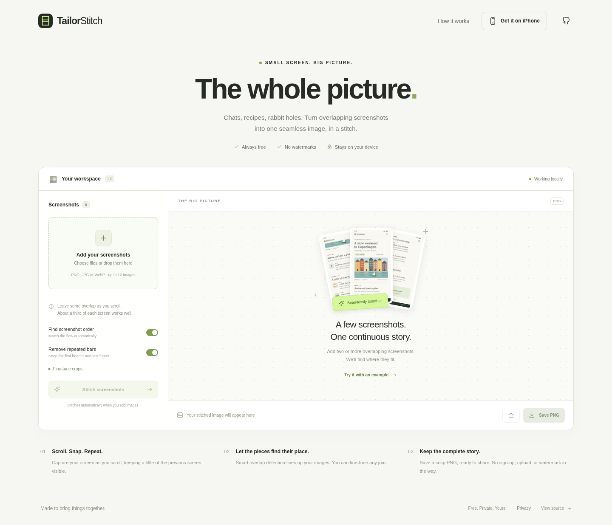

# TailorStitch

**Overlapping screenshots, one complete picture.** A free screenshot stitcher for the web and iPhone. All image processing happens on the device, with no account, image upload, ads, or watermarks.



## Use it

**[Open TailorStitch on the web](https://dev1niscool.github.io/TailorStitch/)** · **[Download the iPhone IPA](https://github.com/dev1niscool/TailorStitch/releases/latest/download/TailorStitch-unsigned.ipa)**

The web app is published on GitHub Pages. Future updates are deployed by [Test and publish web app](../../actions/workflows/web.yml).

1. Take overlapping screenshots while scrolling vertically. Keep about a third of the previous screen visible.
2. Add two or more PNG, JPEG, or WebP images from the same screen size. They are automatically matched and stitched.
3. Review the preview. Open **Adjust visually** to trim the upper image, then drag it over the lower image with a translucent overlay. The dashed scissors line shows where the lower image will begin. Confirm the join before exporting.
4. Save a PNG, or use Share. On iPhone, add the website to your Home Screen from Safari.

The bundled **Try it with an example** uses original fictional screenshots and exercises the actual stitching engine.

In the join editor, crop the bottom of the upper image first, then align it with the lower image. Dragging the upper image down cuts more from the top of the lower image. The overlay helps line up repeated text; **Show cut result** shows the retained pixels. Cancel discards the draft. Confirmed cuts can be reopened and adjusted. Keyboard and button controls are available alongside dragging.

## Features

- Automatic vertical overlap detection and screenshot ordering.
- Removal of repeated app headers and footers at joins, retaining the first header and final footer.
- Exact duplicate removal.
- Visual join editing: trim the upper screenshot, drag to align a translucent overlay, and preview the scissors cut before confirming.
- Manual reordering, global top/bottom crops, and reversible per-join cuts.
- Conservative review mode: uncertain matches preserve all content and require confirmation before export.
- On-device processing in a web worker, with cancellation.
- PNG export and supported browser/native share sheets.
- Responsive, installable web app with offline support after its initial cache completes.
- Bundled iPhone app using Capacitor, native sharing, an Xcode project, simulator CI, and an unsigned device IPA for sideload signing.

## Development

Use Node.js **22.12 or newer**.

```sh
npm ci
npm run dev
```

Build and test:

```sh
npm test
npm run build
npx playwright install --with-deps chromium webkit
npm run test:e2e
```

The production build is in `dist/`. Relative URLs support GitHub Pages project paths such as `/TailorStitch/`. The build generates a versioned service worker that caches only the app and its example assets.

See [publishing instructions](docs/PUBLISHING.md), [iPhone installation and signing](docs/IOS.md), and [stitching algorithm and research](docs/ALGORITHM.md).

## iPhone

The native iPhone app bundles the same interface and engine in a local WKWebView. It does not require the website to be reachable.

**[Download the unsigned iPhone IPA](https://github.com/dev1niscool/TailorStitch/releases/latest/download/TailorStitch-unsigned.ipa)** from [GitHub Releases](https://github.com/dev1niscool/TailorStitch/releases/latest), then follow the [sideloading guide](docs/SIDELOADING.md). Recipients sign the IPA using their own sideloading tool; the build needs no owner's Apple credentials. Tapping the download alone does not install it.

The repository and release downloads are public. No GitHub account is required to download the IPA.

To build and run from source instead:

```sh
npm run ios:sync
npm run ios:open
```

Open the existing Xcode project on a Mac, select your signing team and bundle identifier, and run on your device. A free Apple Personal Team can be used for personal development installs under Apple's restrictions. App Store/TestFlight distribution requires the appropriate Apple membership and signing. No signed App Store release is included. See the [complete iPhone guide](docs/IOS.md).

## Limits and privacy

This version stitches **vertical screenshots of the same pixel width**. It cannot recover uncaptured content. Repeated text, blank areas, animations, expanding headers, different zoom levels, and sideways movement may need manual adjustment.

Up to 12 images are accepted. Each source must be at most 25 MB and 24 megapixels. Sources wider than 1,440 px are resized to that width; the batch is limited to 20 megapixels after resizing. Output is limited to 16 megapixels and 16,384 px tall to reduce mobile canvas/memory failures. Crop coordinates refer to these processed pixels; the visual editor converts gestures to source rows without resampling the originals.

Screenshots stay in memory until cleared or the app closes. They are never cached by the service worker or uploaded. Native sharing creates a temporary file and removes it after the share sheet finishes. Hosting providers may log normal requests for website assets. See [privacy details](docs/PRIVACY.md).
